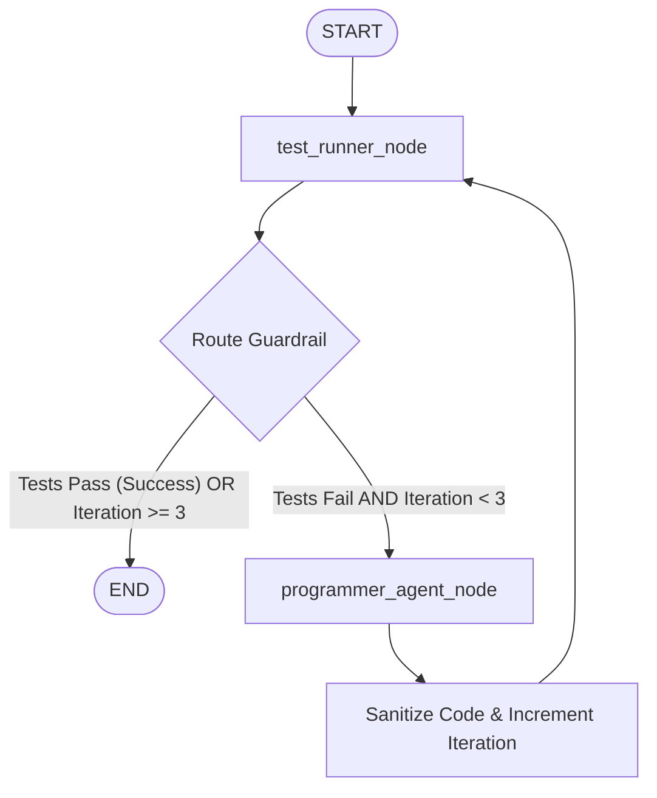

# Autonomous Self-Healing Code Debugging Agent

[](https://self-healing-debugging-agent-v1.streamlit.app/)

An execution-guided, stateful multi-agent system built with **LangGraph**, **Pydantic v2**, and **pytest** that programmatically detects, reasons about, and corrects Python code bugs using real-time execution feedback.

🚀 **Live Demo:** [self-healing-debugging-agent-v1.streamlit.app](https://self-healing-debugging-agent-v1.streamlit.app/)

---

## System Architecture & Control Flow

The agent runs as a cyclic StateGraph with explicit state management and execution-based validation guardrails:



---

## Core Features

*   **Compiler-in-the-Loop Validation**: Executes unit tests in an isolated temporary directory sandbox using Python's `subprocess` engine to capture stdout, stderr, and raw trackbacks.
*   **Structured Output Typing**: Enforces JSON-structured responses from LLMs via **Pydantic v2 validation** (`.with_structured_output`), ensuring clean patches and logic rationales are parsed reliably.
*   **Hybrid Cloud-Edge Architecture**: Features a dynamic socket connection check that falls back to a local, fine-tuned code model running offline (**Qwen2.5-Coder via Ollama**) if external Cloud APIs (Google Gemini, OpenAI) are unavailable or restricted by data privacy policies.
*   **Billing & Execution Guardrails**: Utilizes state persistence (`AgentState`) to prevent infinite looping, terminating execution once tests pass or a maximum iteration threshold (3 attempts) is reached.
*   **Interactive Streamlit Dashboard**: Provides a clean, professional web interface to run presets, paste custom code, select LLM providers, and view real-time node execution steps.

---

## File Structure

*   `app.py`: Streamlit-based web dashboard displaying configurations and real-time execution streaming.
*   `graph.py`: LangGraph StateGraph workflow definition, conditional edges, and main console CLI entry point.
*   `nodes.py`: Execution nodes (`test_runner_node` and `programmer_agent_node`) managing LLM binding and code sanitization.
*   `tools.py`: Safe, isolated test runner utilizing pytest in temporary OS directories.
*   `state.py`: Global `AgentState` definition and Pydantic schemas.
*   `requirements.txt`: Package dependency list.
*   `.gitignore`: Git rules protecting environment secrets and local runtime logs.

---

## Quick Start

### 1. Installation
Clone the repository and install dependencies inside a virtual environment:
```bash
git clone https://github.com/Piano-V/self-healing-debugging-agent.git
cd self-healing-debugging-agent

python3 -m venv venv
source venv/bin/activate
pip install -r requirements.txt
```

### 2. Configure Credentials
Set up your chosen model provider (e.g., Google Gemini):
```bash
export GEMINI_API_KEY="your-google-api-key"
```

### 3. Run via CLI
To run the default self-healing loop (Merge Intervals algorithmic challenge) in your console:
```bash
python3 graph.py
```

### 4. Run via Web Dashboard
To launch the interactive dashboard:
```bash
streamlit run app.py
```
Open `http://localhost:8501` in your browser.
